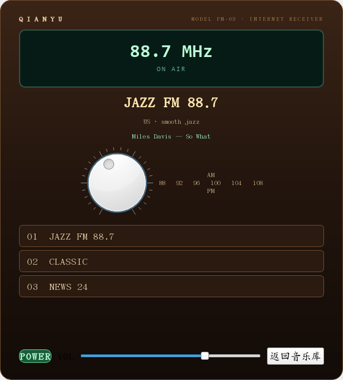

# 三种使用形态

## 音乐模式

默认主窗口，参考经典千千静听：

- 左侧媒体库/封面网格；
- 中间播放队列；
- 右侧歌词；
- 底部传输控制；
- 「视图 → 经典音乐模式」打开全屏大封面/歌词页。

## 电台模式

播放网络电台时自动打开经典台式收音机窗口：

- 木纹/深色机身、绿色荧光屏；
- 大号频率显示（名称含频率时自动识别）；
- 装饰性调谐旋钮；
- 预设电台按钮（来自收藏/最近收听）；
- POWER/音量/返回音乐库；
- ON AIR、ICY 当前曲目、断流重连状态。

实现：`ui/radio_window.py`。

## 视频模式

独立 `VideoWindow`：

- 黑色视频画布，控制栏在视频下方；
- 本地文件/URL、播放列表、字幕/音轨、截图、章节、书签；
- 全屏使用 mpv OSC；
- 经典“画布 + 底部控制”布局。

实现：`ui/video_window.py`。
